<div align="center">

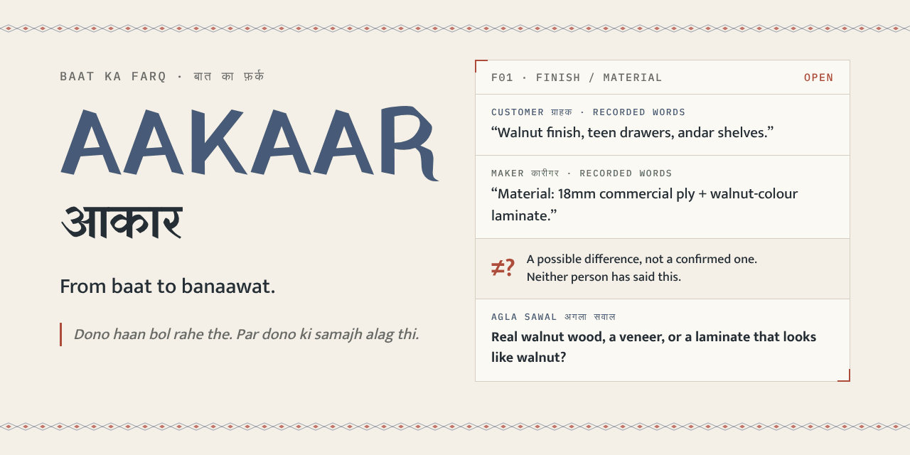

# AAKAAR · आकार

**From baat to banaawat.** A voice native work folio for custom jobs.

*Dono haan bol rahe the. Par dono ki samajh alag thi.*
Both said yes. They were picturing different things.


</div>

---

AAKAAR helps a customer and a maker (carpenter, tailor, mason, upholsterer) find out **before the work starts** that they are not talking about the same thing. It lines up the quotes, listens to both sides, points at the words that may mean different things, asks the one question that would settle it, writes the plan down in a form both people can confirm and later sets what was reported as delivered beside what was agreed.

It does not decide who is right. It does not pick the cheapest quote. It does not claim a plan is agreed when only one person pressed a button. Every claim on screen says where it came from.

<div align="center">
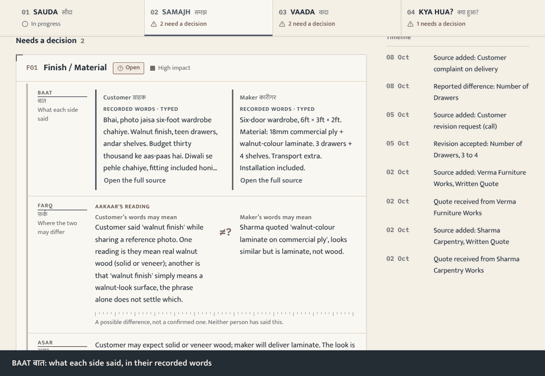

<sub>Eight real screenshots of the running app on its built-in synthetic demo (invented people, no real data), taken from scripted clicks and captioned.</sub>
</div>

## The idea in one example

A customer sends a photo and says *"walnut finish."* The maker's quote says *"walnut colour laminate."* Both nod. Nothing in the quote is wrong and nothing in the brief is wrong. The disagreement only appears at delivery.

| | |
|---|---|
| **BAAT** बात, what was said | Customer: *"Walnut finish, teen drawers, andar shelves."* Maker: *"Material: 18mm commercial ply + walnut-colour laminate."* |
| **FARQ** फ़र्क, where it may differ | "Walnut finish" could mean real walnut (solid or veneer) or only a walnut look. The phrase alone does not settle which. *A possible difference, not a confirmed one.* |
| **ASAR** असर, why it matters | The look is similar, the feel and the life of the piece are not, and the price is not. |
| **AGLA SAWAL** अगला सवाल, next question | *"When you said 'walnut finish', were you imagining real walnut wood, a veneer, or a laminate that looks like walnut?"* (can be read aloud) |
| **JAWAB** जवाब, the answer | Written down in the words it was given. |
| **STATUS** | Open, Answered, or Clarified. An answer is not a clarification. |

When both sides say laminate, AAKAAR says there is no difference. When both sides write only "walnut finish", it says the phrase is ambiguous and asks. It will not invent a mismatch to look clever.

## Try it in two minutes (no keys)

```bash
git clone https://github.com/SWARNIM-TIWARI/aakaar.git
cd aakaar
npm install
cp .env.example .env.local        # REASONING_PROVIDER=demo needs no keys
npm run dev
```

Open <http://localhost:3000>, press **Open demo**, and walk the four stages:

1. **SAUDA** : see two quotes in one ledger, including what each one leaves out.
2. **SAMAJH** : open the walnut finding, write an answer, mark it clarified, add it to the plan.
3. **VAADA** : the answer is waiting as a *proposed* field. Mark it confirmed once as customer and once as maker.
4. **KYA HUA?** : record a delivery report. Try `yes` against an agreed price and see it called *cannot be compared* instead of *different*.

Or press **Naya kaam**, type or speak what each side said, and start your own job.

## The four stages

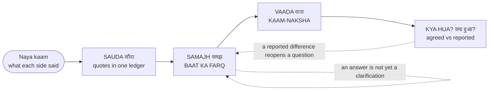

| Stage | What you are looking at | What it will not do |
|---|---|---|
| **SAUDA** सौदा | A ledger: each maker is a column; items, prices, what is included, what is left out, and what is only priced by one quote. A like-for-like total covers only items every quote prices. | Pick a winner, or add up unlike things as if they matched. |
| **SAMAJH** समझ | **BAAT KA FARQ** बात का फ़र्क: statements side by side, the possible difference, why it matters, the next question, the answer. | Call a possible difference a confirmed one, or treat an answer as agreement. |
| **VAADA** वादा | **KAAM-NAKSHA** काम-नक्शा: the written plan, field by field, with where each field came from. Customer and maker confirm separately. | Show an unclear field as clear, or turn "lowest price wins" into a material or a quantity. |
| **KYA HUA?** क्या हुआ? | What was agreed, set beside what each person reported as delivered, who reported it, and the note behind it. | Verify the work, or call "yes" against INR 4,400 a difference. |

<details>
<summary><b>Four kinds of statement, always kept apart</b></summary>

<br>

| On screen | Meaning |
|---|---|
| **RECORDED WORDS** | What a person typed or spoke. For speech, the transcript as returned is kept, and a corrected copy never replaces it. |
| **AAKAAR'S READING** | An inference by the reasoning model. Nobody said it. |
| **UNRESOLVED** | An ambiguity nobody has settled. It stays visible. |
| **CLARIFIED BY A PERSON** | Someone pressed a button for a role. It is a record of a button press, not a verified identity. |

</details>

## Screens

<div align="center">
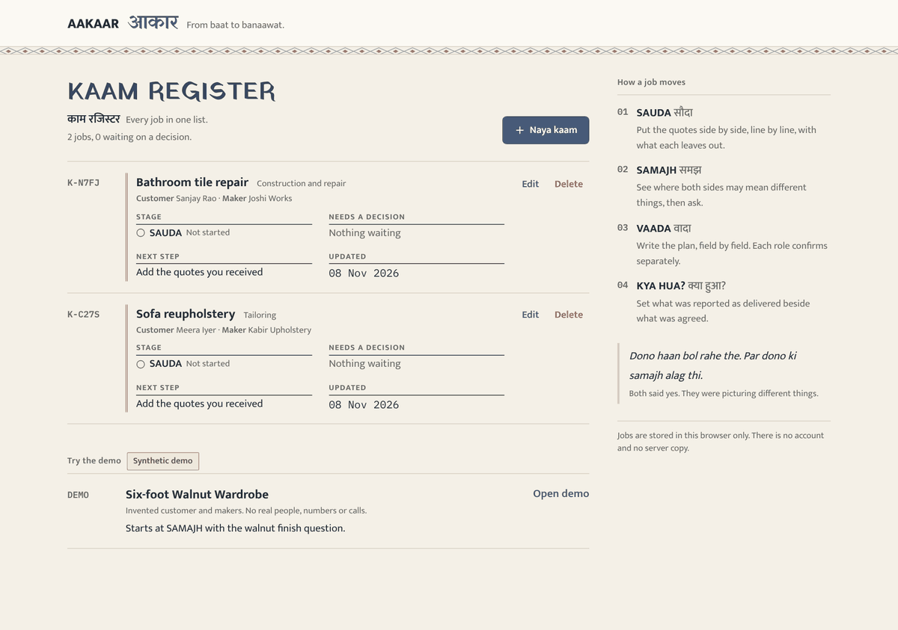

<sub><b>KAAM REGISTER</b> काम रजिस्टर. Every job: type of work, customer and maker, stage, what needs a decision, the next step, last updated.</sub>
</div>

<br>

<div align="center">
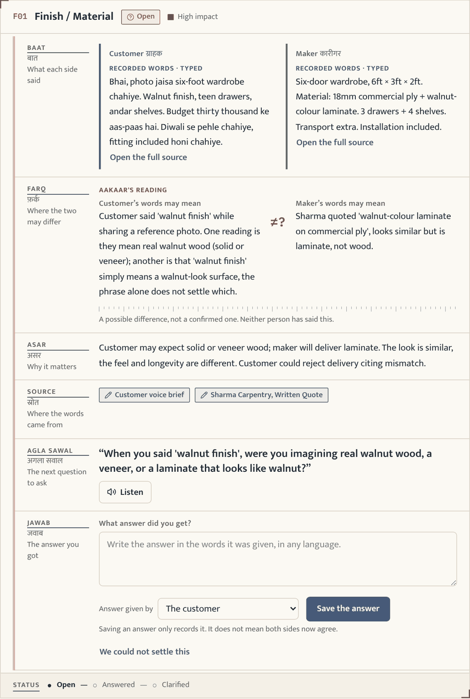

<sub><b>One finding.</b> The strongest screen in the product: seven labelled rows on a ledger page, a status line at the foot.</sub>
</div>

<details>
<summary><b>Naya kaam: customer, maker, notes, voice</b></summary>

<br>
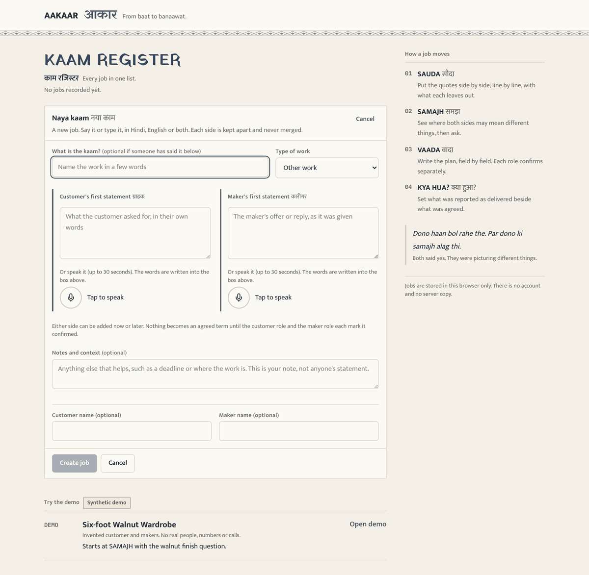

Customer's statement, maker's statement, and notes are separate. Each can be typed or spoken. For speech the original transcript is kept; editing it saves a clearly marked correction and never claims the corrected text is what was said.
</details>

<details>
<summary><b>SAUDA: the comparison ledger</b></summary>

<br>
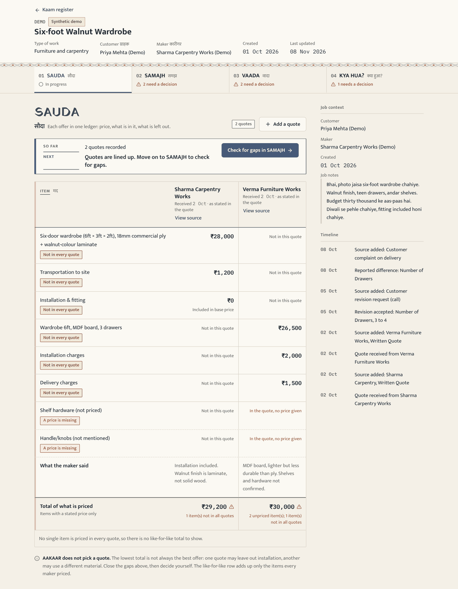
</details>

<details>
<summary><b>VAADA: KAAM-NAKSHA</b></summary>

<br>
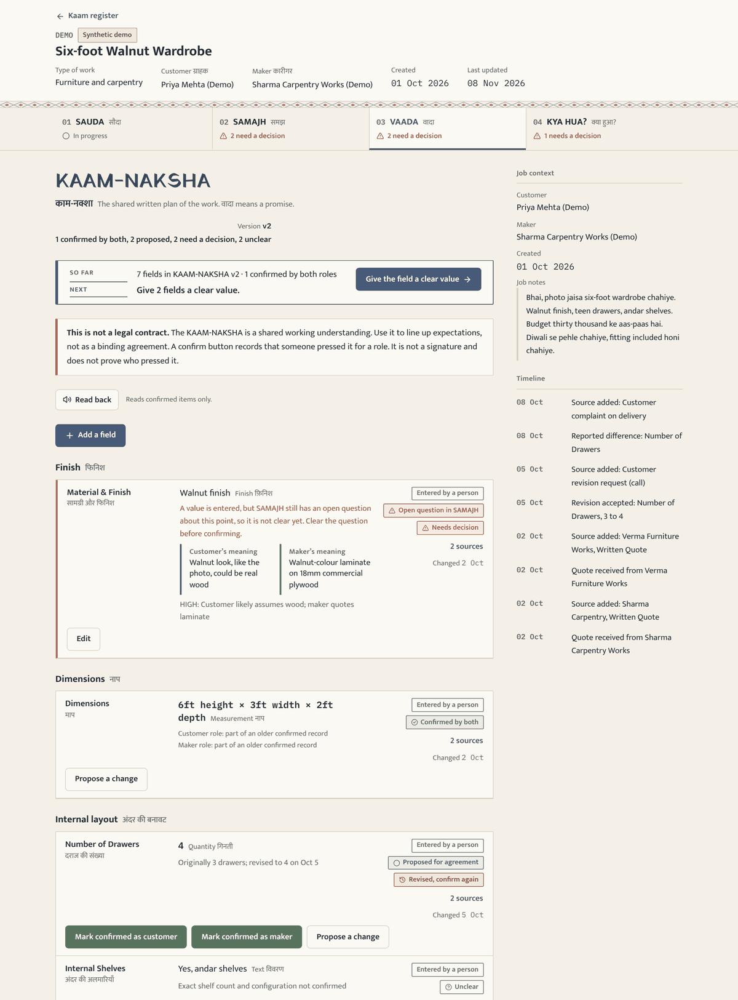

Fields are *suggested*, *entered*, *proposed*, then *confirmed by the customer role*, *by the maker role*, or *by both*. The version number counts changes to the content of the plan. A confirmation does not bump it.
</details>

<details>
<summary><b>KYA HUA?: agreed vs reported</b></summary>

<br>
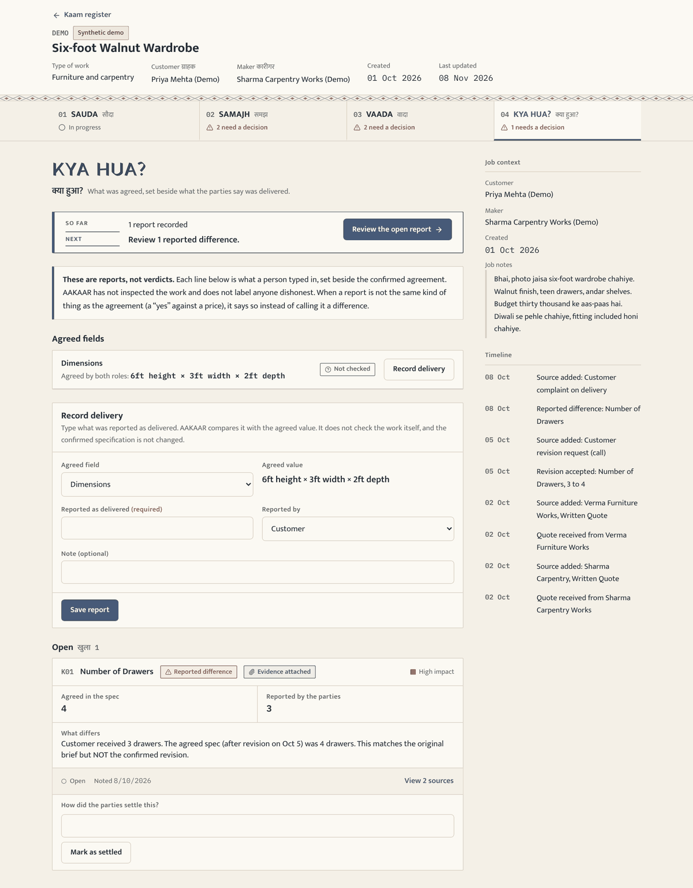

A report is a person typing what they say arrived. A second report on the same field gets a warning before it is saved. A report is never presented as independently checked.
</details>

<details>
<summary><b>On a phone (390 px)</b></summary>

<br>
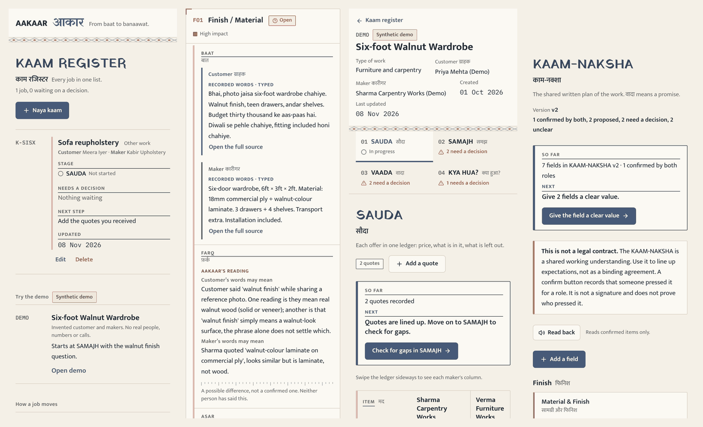

No page-level sideways scroll. The SAUDA ledger scrolls inside its own frame.
</details>

## Voice, and who does what

Three separate things make AAKAAR work. They are different services and the README keeps them apart on purpose.

| Job | Provider | Where it runs |
|---|---|---|
| **Speech to text** | **Gnani.ai** speech API, model **Prisma v2.5**, `POST https://api.vachana.ai/stt/v3`. Voice input is set to `hi-IN`. | Server route `/api/gnani/transcribe` |
| **Text to speech** | **Gnani.ai** speech API, model **Timbre v3.0**, `POST https://api.vachana.ai/api/v1/tts/inference`, default voice `Avinash`, speed clamped to 0.85 to 1.15. | Server route `/api/gnani/speak` |
| **Finding the gaps** (reasoning) | **Not Gnani.** Whatever model you configure: the built-in deterministic `demo` provider, any OpenAI-compatible endpoint (for example Groq), or an optional local endpoint. | Server route `/api/reason` |

- Without a Gnani key, voice input falls back to the browser's own speech recognition (Chrome and Edge). Text-to-speech then needs the key.
- The Gnani key stays on the server. It is never in a `NEXT_PUBLIC_*` variable, never sent to the browser. AAKAAR does not store audio.
- AAKAAR makes no claim that Evon or any other model is running. `evon-local` is only the name of an optional local OpenAI-style endpoint you can point at yourself.

<details>
<summary><b>Reasoning provider notes</b></summary>

<br>

Set `REASONING_PROVIDER` to `demo`, `openai-compatible`, or `evon-local`. An unknown value fails loudly; there is no silent fallback. The provider that produced each analysis is stored with it and shown on screen, and the demo provider is labelled as such.

For Groq, `.env.example` suggests `openai/gpt-oss-120b` with `openai/gpt-oss-20b` as the faster fallback. Groq's `llama-3.3-70b-versatile` and `llama-3.1-8b-instant` were scheduled to shut down on 16 August 2026, and the suggestion was checked against Groq's model pages on 7 November 2026. Model catalogues move; check again before you rely on it. `GET /api/reason/status` reports, without exposing the key, whether the configured key is accepted.

The model only extracts structure and suggests questions. **All arithmetic is in ordinary code** (`lib/spec/calculations.ts`, `lib/spec/values.ts`). Numbers in a statement are treated as money, quantity, length, date or "unclear" by rule, and a stray number is never turned into a per-item rate.
</details>

## Architecture

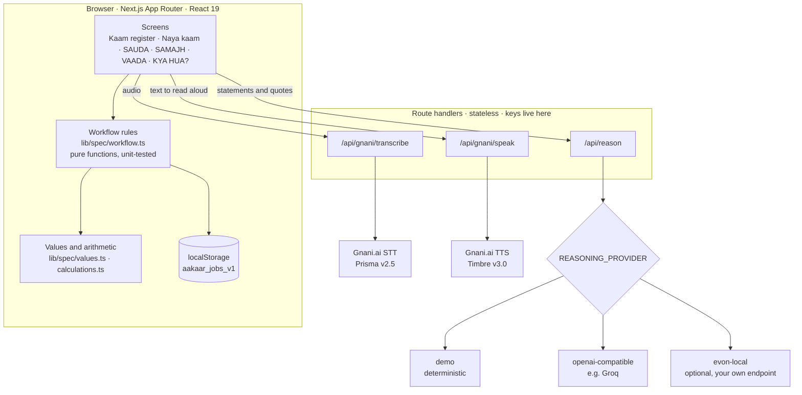

- **Local first.** Jobs live in the browser's `localStorage`. There is no account and no server copy. The route handlers hold no state.
- **Workflow as pure functions.** Every transition (record an answer, mark clarified, confirm a field, record a delivery) takes a job and returns a new job or throws a plain-sentence error. The screens only wire buttons to them.
- **Validated at the edge.** Every model response is parsed with Zod before use.
- **Fonts are bundled.** Mukta, Yatra One and IBM Plex Mono ship with the app. Opening AAKAAR makes no request to a font CDN.

<details>
<summary><b>Project layout</b></summary>

<br>

```
app/
  page.tsx                  KAAM REGISTER and Naya kaam
  job/[id]/page.tsx         job workspace: header, progress, stage
  api/gnani/{transcribe,speak,status}/   Gnani routes (keys server-side only)
  api/reason/{,status}/                  reasoning adapter
components/
  modules/{Sauda,Samajh,Vaada,KyaHua}Module.tsx
  NextBar.tsx  NewJobForm.tsx  VoiceRecorder.tsx  ListenButton.tsx  EvidenceDrawer.tsx ...
lib/
  spec/{workflow,values,calculations,diff}.ts
  ai/{reasoner,schemas,requestSchema,sanitizer}.ts  ai/providers/demo.ts
  gnani/client.ts  storage/repository.ts  utils/{terms,jobStage,newJob,fieldKey}.ts
  data/demo-scenario.ts     the synthetic demo job
__tests__/                  11 suites
docs/                       evaluation framework, screenshots, repo kit
```
</details>

## Configuration

Copy `.env.example` to `.env.local`. Every value below is a placeholder. Never commit `.env.local`; it is git-ignored, and `.env.example` is tracked.

| Variable | Needed when | Notes |
|---|---|---|
| `REASONING_PROVIDER` | always | `demo` (default, no keys), `openai-compatible`, `evon-local` |
| `OPENAI_COMPATIBLE_BASE_URL` | `openai-compatible` | e.g. `https://api.groq.com/openai/v1` |
| `OPENAI_COMPATIBLE_API_KEY` | `openai-compatible` | `your_key_here`, server only |
| `OPENAI_COMPATIBLE_MODEL` | `openai-compatible` | e.g. `openai/gpt-oss-120b` |
| `OPENAI_COMPATIBLE_MAX_TOKENS`, `_REASONING_EFFORT`, `_JSON_MODE` | optional | reasoning models spend tokens thinking, default budget 4096 |
| `EVON_LOCAL_BASE_URL`, `EVON_LOCAL_MODEL` | `evon-local` | your own local endpoint |
| `GNANI_API_KEY` | live voice | server only. Blank means browser speech fallback and no read-aloud |
| `GNANI_STT_URL`, `GNANI_TTS_URL` | optional | defaults are the production endpoints above |
| `NEXT_PUBLIC_APP_NAME`, `NEXT_PUBLIC_SHOW_DEMO_BANNER` | optional | display only. Never put a secret in a `NEXT_PUBLIC_*` variable |

Restart `npm run dev` after editing `.env.local`. A stale variable set in your shell wins over the file, so if a key seems ignored, check `echo $GNANI_API_KEY` (PowerShell: `$env:GNANI_API_KEY`).

## Tests

```bash
npm test          # unit and logic tests
npm run lint
npx tsc --noEmit
npm run build
```

The tests covers:
- **A. A true difference** (veneer vs walnut-look laminate) is flagged.
- **B. No difference** (both say laminate) is not flagged.
- **C. Ambiguity** (both say "walnut finish") is reported as ambiguity, not as a proven mismatch.
- **D. Money** (a festival-crackers order where numbers are amounts) never invents a per-item rate; "lowest price wins" never becomes a material or quantity.
- **E. Confirmation and versions.** Confirmation never bumps the version; a changed value does; the same role cannot mark twice; a field with an open question cannot be confirmed.
- **F and G. Delivery.** `INR 4,400` vs `yes` is *cannot be compared*, not *different*; a repeated report on the same field is warned about.
- **H. Persistence.** Reload keeps answers, confirmations and reports.
- **I. Voice provenance.** Original transcript kept, correction marked, corrected text never presented as spoken.

**Live model check (optional).** Whether a real model judges cases A to C well cannot be decided by a unit test. With a real key in `.env.local`:

```bash
EVAL_LIVE=1 npx jest reasoning-live
```

See [`docs/BAAT_KA_FARQ_EVALUATION.md`](docs/BAAT_KA_FARQ_EVALUATION.md) for the cases and what a provider must pass before a demo.

## Honest status

| Area | Where it stands |
|---|---|
| Workflow, values, arithmetic | Unit-tested. |
| Screens, reload persistence, phone widths | Exercised in a real browser (Playwright) during development. Those browser scripts are not in this repo yet. |
| Voice | Recording, transcript keeping, correction and playback were exercised in a browser with the Gnani endpoints **stubbed**. Live calls need your own key. |
| Reasoning | Request, retry and error handling are tested against a mock OpenAI-compatible server. How well a live model judges real statements is untested until you run the live check above. |
| Production dependencies | `npm audit --omit=dev` reports 0 vulnerabilities (8 November 2026). 27 low and moderate advisories remain in the **dev** toolchain (Jest and friends). They are not in the built app; they were not force-fixed because that breaks the toolchain. |

**Limits worth knowing**
- Jobs live in one browser on one device. Clearing site data deletes them. There is no export yet.
- A role confirmation is a button press. It is not a signature, not an identity check, and **not a legal contract**.
- AAKAAR compares what people *report* with what was agreed. It cannot see the work.
- Findings are suggestions from a model. A person decides.
- Voice input is set to Hindi (`hi-IN`). The interface is English and Hindi, with Hinglish accepted as input; other Indian languages are not yet in the interface.
- Without a Gnani key, read-aloud is unavailable.

## Roadmap

- Export a job as a printable folio (PDF) that carries the version history.
- Share a KAAM-NAKSHA to the other person (for example over WhatsApp) so the second confirmation can happen on their own device.
- Photo evidence on a finding, with the same *recorded / inferred / clarified* separation.
- A language choice for voice input and more Indian languages in the interface.
- Playwright journeys checked into the repo and run in CI.
- Optional sync, behind the existing storage adapter, for people who want it.

## Design

The look is called **the contemporary Indian work folio**: a bahi-khata ledger page for structure, block-print registration marks on the finding, an Ajrakh style diamond rule, the open space of a jali, a hand painted signboard face for a few headings and measurement ticks on the FARQ row. Paper `#F4F0E7`, ink `#252D35`, indigo `#475A78`, madder `#AE4C3B`, ochre `#AC8442`, green `#58735D`. No decorative shadows, glows, gradients or card grids. Colour never carries meaning alone. These are influences not claims of authenticity. No pattern is copied from a specific textile.

Typefaces: **Mukta** (Devanagari and Latin, all interface text), **Yatra One** (signboard moments), **IBM Plex Mono** (numbers, ids, dates). All three are open licensed fonts from Fontsource packages.

## Credits

- Built by [Swarnim Tiwari](https://github.com/SWARNIM-TIWARI).
- Speech-to-text and text-to-speech: [Gnani.ai](https://gnani.ai) speech APIs. Built for the Gnani.ai Great Indian AI Internship Challenge. AAKAAR is an independent project and is not endorsed by Gnani.ai.
- Reasoning: the provider you configure. It is a separate service from Gnani.
- Stack: Next.js 16, React 19, TypeScript, Tailwind CSS 4, Zod 4, Lucide, Jest.

## Licence

All rights reserved. See [`LICENSE.md`](LICENSE.md). You are welcome to read the code and try the app; reuse beyond that needs the author's written permission.
